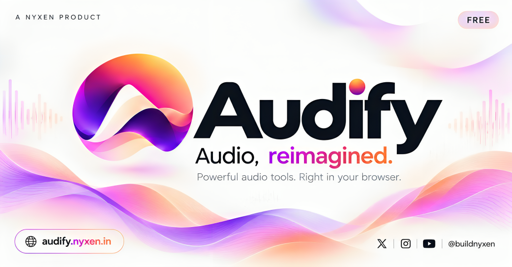

<div align="center">


# Audify

### Sound, reimagined.

[](https://github.com/YashShinde024/audify/actions/workflows/ci.yml)
[](https://vitest.dev/)
[](https://nextjs.org/)
[](https://react.dev/)
[](https://www.typescriptlang.org/)
[](https://tailwindcss.com/)
[](LICENSE)

**Audify by Nyxen × Xpert Melody**  
*Software Engineering & Product Development:* **Nyxen** ([support@nyxen.in](mailto:support@nyxen.in))  
*Music Production & Acoustic Partnership:* [**Xpert Melody**](https://www.youtube.com/@xpertmelody)  
Canonical Production Platform: [**https://audify.nyxen.in**](https://audify.nyxen.in)

</div>

---

Audify is an open-source, browser-based audio digital signal processing (DSP) workstation that combines creative audio effects, acoustic presets, precision editing utilities, and task-oriented audio tools. Designed for artists, producers, podcasters, and music lovers, Audify executes audio transformations directly inside your web browser using the W3C Web Audio API and `OfflineAudioContext`—eliminating cloud file uploads, server wait queues, paywalls, and user accounts.

---

## Table of Contents

- [Overview](#overview)
- [Key Features](#key-features)
- [Verified Inventory Counts](#verified-inventory-counts)
- [Interface Preview](#interface-preview)
- [System Architecture](#system-architecture)
- [Technology Stack](#technology-stack)
- [Supported Formats & Encoders](#supported-formats--encoders)
- [Quick Start & Local Setup](#quick-start--local-setup)
- [Available Commands](#available-commands)
- [Environment Variables](#environment-variables)
- [Documentation Index](#documentation-index)
- [Privacy & Security Model](#privacy--security-model)
- [Community & Contributing](#community--contributing)
- [License](#license)

---

## Overview

Traditional online audio converters and effects sites often require users to upload sensitive audio files to unknown cloud servers, introduce lossy transcoding passes, enforce artificial wait queues, or gate core functionality behind subscriptions.

Audify redefines this experience by bringing DAW-grade digital signal processing into the client browser. When you drop an audio file into Audify, it is decoded into 32-bit floating-point PCM buffers in your machine's volatile memory. Filtering, convolution reverb, spatial panning, dynamic leveling, and binary encoding happen on your local CPU.

### Who Is Audify For?
- **Music Creators & Producers:** Quickly audition viral treatments (Slowed + Reverb, Nightcore, Daycore, 8D Audio, Lo-Fi Tape) or fine-tune frequencies with parametric EQ before exporting.
- **Audio Engineers & Audiophiles:** Convert sample rates, adjust stereo width with Haas precedence, inspect waveform metadata, and encode broadcast-grade 16/24/32-bit WAV or high-bitrate MP3s.
- **Podcasters & Content Creators:** Normalize audio levels, apply vocal clarity and de-harshing, cut unwanted silence, merge interviews, or split long recordings into chapters.

---

## Key Features

### 1. Creative Audio Presets & Effects
- **Trending & Speed Shifting:** Slowed + Reverb (with independent semitone pitch adjustment), Super Slowed, Sped Up, Nightcore, Daycore, Vaporwave.
- **Acoustic Spaces & Reverb:** Algorithmic convolution reverb synthesis simulating Bathroom, Small Room, Medium Live Room, Large Concert Hall, Church Hall, Monumental Cathedral, and Vocal Plate.
- **Spatial & Binaural:** 8D Audio (smooth 360° sinusoidal orbital panning for headphones), Haas Precedence Spatializer, balanced Stereo Widening, Auto-Panner, and Ping-Pong cross-channel delays.
- **Harmonics & Character:** Lo-Fi Tape saturation with flutter, Analog Tube Warmth, Vintage AM Radio bandpass, Underwater lowpass cascade, Telephone Voice, and Bitcrusher.
- **Acoustic Retuning:** 432 Hz Verdi sacred concert pitch conversion via mathematically exact varispeed ratio calculation ($432/440 \approx 0.981818$).

### 2. Dynamics & Headroom Protection
- **4-Tier Bass Reinforcement:** Light (+3.5 dB), Moderate (+7.0 dB), Heavy (+10.5 dB), and Extreme (+15.0 dB) with calibrated negative pre-trim staging to prevent limiter pumping.
- **Sliding-Window Soft-Knee Peak Limiter:** Automatic look-ahead protection preventing harsh digital clipping above −0.3 dBFS ($0.966$) across all rendering pipelines.

### 3. Task-Oriented Audio Tools (`/tools/[slug]`)
15 standalone utilities for dedicated audio editing workflows:
- **Audio Trimmer & Cutter:** Millisecond-accurate cropping with automatic 5ms anti-click crossfades.
- **Audio Merger & Joiner:** Sequential multi-file stitching with configurable silence intervals and automatic sample rate alignment.
- **Audio Splitter:** Segment audio by equal parts or fixed time intervals (e.g., 30s snippets).
- **Audio Converter:** Binary conversion between WAV, AIFF, and MP3.
- **Sample Rate Converter:** Windowed-sinc resampling between 22.05 kHz, 32 kHz, 44.1 kHz, and 48 kHz.
- **Audio Normalizer:** Sample-peak normalization and EBU R128 dynamic leveling.
- **Vocal Remover:** Center-channel extraction and phase cancellation matrix.
- **Audio Metadata & Diagnostics:** Real-time waveform inspection, RMS measurement, sample rate readouts, and JSON export.

### 4. Custom Presets & Real-Time Playback
- Interactive dual waveform timeline with scrubbable playhead, dry/wet comparison toggle, and master volume.
- Save, export, and import personalized DSP configurations locally in browser storage (`audify-custom-presets-v1`).

---

## Verified Inventory Counts

All figures below are programmatically verified against the codebase registries and test suites:

| Category | Verified Count | Source File |
| :--- | :---: | :--- |
| **Built-in Audio Presets** | **62 modules** | [`src/config/presets.ts`](./src/config/presets.ts) |
| **Standalone Audio Tools** | **15 tools** | [`src/config/tools-registry.ts`](./src/config/tools-registry.ts) |
| **Preset Categories** | **8 categories** | [`src/config/presets.ts`](./src/config/presets.ts) |
| **Supported Import Formats** | **6 formats** | WAV, MP3, FLAC, OGG, AAC, M4A |
| **Supported Export Formats** | **3 containers / 5 encodings** | WAV (16-bit, 24-bit, 32-bit float), AIFF, MP3 (128–320 kbps) |
| **Automated Test Suites** | **23 test files (301 tests)** | [`vitest.config.ts`](./vitest.config.ts) |
| **Maximum Audio File Size** | **10 MB (safe RAM limit)** | [`src/config/site.ts`](./src/config/site.ts) |

---

## Interface Preview

Audify is built on the **Quartz & Sonic** design system: Light mode delivers crisp Quartz paper surfaces (`#F8F7F5`) with ink typography, while Dark mode immerses creators in a deep graphite workstation (`#111016`) accented by Audify Violet (`#772BEE`) and conic sweep gradients.

<div align="center">
  
</div>

---

## System Architecture

Audify enforces a strict architectural boundary between client-side audio DSP operations and server-side web application delivery.

```mermaid
flowchart TD
    subgraph Client ["Client Browser Runtime (Zero-Upload Sandbox)"]
        A[User Audio File: WAV / MP3 / FLAC / OGG / AAC] -->|File Drag / Drop| B[Browser Memory Blob & FileReader]
        B --> C[AudioContext.decodeAudioData]
        C --> D[Float32Array PCM AudioBuffer]
        
        subgraph DSP ["Web Audio Engine (src/lib/audio/)"]
            D --> E[resolveProcessing: DSPPlan Graph]
            E --> F[Varispeed PlaybackRate / Pitch]
            F --> G[BiquadFilterNodes: Lowpass / Highpass / Peaking EQ]
            G --> H[WaveShaperNode: tanh Harmonic Saturation]
            H --> I[StereoPanner / Haas Delay Matrix]
            I --> J[ConvolverNode: Synthesized Impulse Response]
            J --> K[DynamicsCompressorNode]
            K --> L[Sliding-Window Soft-Knee Peak Limiter -0.3 dBFS]
        end
        
        L -->|Live Audition| M[AudioDestinationNode / Speakers]
        L -->|Offline Render| N[OfflineAudioContext]
        N --> O[Master Rendered AudioBuffer]
        
        subgraph Encoders ["Binary Encoders (src/lib/audio/encoders.ts)"]
            O --> P[WAV Encoder: 16-bit / 24-bit / 32-bit float]
            O --> Q[AIFF Encoder: 16-bit Big-Endian PCM]
            O --> R[MP3 Encoder: lamejs CBR 128 / 192 / 320 kbps]
        end
        
        P --> S[Client Blob: URL.createObjectURL]
        Q --> S
        R --> S
        S -->|Standardized Filename| T[Browser Download Trigger]
    end

    subgraph Server ["Server / Edge Runtime (Next.js 16)"]
        U[Static App Delivery & CDN Assets]
        V[Contact Dispatch API: /api/contact]
        W[In-Memory Sliding-Window Rate Limiter: 5 req / 10 min]
        X[Optional Resend / Webhook Forwarder]
        
        V --> W --> X
    end
```



### Deterministic Filename Standardization
All audio exports follow the strict global naming pattern implemented in `src/lib/audio/export-filename.ts`:
```text
Audify-{edit-type}-{song-name}.{extension}
```
*Examples:* `Audify-Slowed-Reverb-Midnight-Drive.wav`, `Audify-Audio-Splitter-Session-Part-01.mp3`.

---

## Technology Stack

Audify uses a modern, battle-tested TypeScript and Next.js foundation:

- **Framework:** [Next.js 16.4.2](https://nextjs.org/) (App Router, Turbopack compiler)
- **UI Runtime:** [React 19.3.0](https://react.dev/)
- **Styling:** [Tailwind CSS v4](https://tailwindcss.com/) with centralized CSS variables
- **Typography:** Self-hosted Google Fonts via `next/font/google`:
  - **Sora:** Display headings & major marketing statements
  - **Manrope:** Interface typography, buttons, inputs, and body copy
  - **IBM Plex Mono:** Technical readouts, sample rates, bitrates, timestamps, and DSP diagnostics
- **State Management:** [Zustand v5](https://zustand-demo.pmnd.rs/) with atomic state selectors
- **Motion & Animations:** [Motion v14.3](https://motion.dev/)
- **Icons:** [Phosphor Icons React v2.1](https://phosphoricons.com/)
- **Audio DSP:** W3C Web Audio API (`AudioContext`, `OfflineAudioContext`, `AudioBuffer`, `BiquadFilterNode`, `ConvolverNode`)
- **Binary Encoders:** Custom bit-level PCM encoders for WAV/AIFF and `lamejs` v1.2.1 for MP3
- **Validation:** [Zod v4](https://zod.dev/)
- **Testing:** [Vitest v3.2.7](https://vitest.dev/)
- **Native Wrapper:** [Capacitor v8](https://capacitorjs.com/) (remote WebView wrapper for Android)

---

## Supported Formats & Encoders

| Format | File Extension | Channel Layout | Sample Rates Supported | Technical Notes |
| :--- | :---: | :---: | :---: | :--- |
| **WAV (16-bit)** | `.wav` | Mono / Stereo | 22.05, 32, 44.1, 48 kHz | Standard linear PCM format; universally compatible. |
| **WAV (24-bit)** | `.wav` | Mono / Stereo | 22.05, 32, 44.1, 48 kHz | Studio-grade resolution with 144 dB dynamic range. |
| **WAV (32-bit float)** | `.wav` | Mono / Stereo | 22.05, 32, 44.1, 48 kHz | Direct 32-bit floating-point export matching internal DSP calculations. |
| **AIFF (16-bit)** | `.aiff` | Mono / Stereo | 22.05, 32, 44.1, 48 kHz | Apple standard big-endian uncompressed PCM. |
| **MP3 (CBR)** | `.mp3` | Mono / Stereo | 32, 44.1, 48 kHz | Encoded client-side via `lamejs` at 128, 192, or 320 kbps. |

---

## Quick Start & Local Setup

### Prerequisites
- **Node.js:** `v20.x` or `v22.x` (LTS recommended)
- **npm:** `v9+` or `v10+`
- **Git**
- **Modern Web Browser:** Chrome, Edge, Firefox, Brave, or Safari with Web Audio API support

### Step 1: Clone the Repository
```bash
git clone https://github.com/YashShinde024/audify.git
cd audify
```

### Step 2: Install Dependencies
```bash
npm ci
```

### Step 3: Configure Environment (Optional)
Audify does not require any environment variables to run locally. If you wish to test contact dispatches or customize the canonical URL, create `.env.local` privately (this file is ignored by Git):

**Linux / macOS:**
```bash
touch .env.local
```

**Windows (PowerShell):**
```powershell
New-Item .env.local -ItemType File
```

### Step 4: Run Development Server
```bash
npm run dev
```

The application will be accessible at:
```text
http://localhost:3000
```

---

## Available Commands

| Command | Action |
| :--- | :--- |
| `npm run dev` | Launches local development server with Next.js Turbopack on `http://localhost:3000`. |
| `npm run build` | Compiles an optimized production build and validates static generation. |
| `npm start` | Starts the production server using the compiled `.next` bundle. |
| `npm test` | Runs the complete automated test suite via Vitest (23 suites, 301 tests). |
| `npm run lint` | Runs ESLint validation across all TypeScript and React files. |
| `npx tsc --noEmit` | Performs strict TypeScript type checks without emitting output. |
| `npx tsx scripts/verify-audio.ts` | Validates DSP math (432 Hz ratio, trim slicing, limiter bounds, WAV headers). |

---

## Environment Variables

All variables are optional. The core DSP engine operates completely offline without configuration.

| Variable Name | Required | Default in Code | Scope | Description |
| :--- | :---: | :--- | :--- | :--- |
| `NEXT_PUBLIC_SITE_URL` | No | `https://audify.nyxen.in` | Client & Server | Canonical site URL used for OpenGraph, sitemap, and SEO tags. |
| `RESEND_API_KEY` | No | *Empty* | Server-Only | Resend API key for contact email delivery. When unset, submissions are safely simulated and logged without PII. |
| `CONTACT_TO_EMAIL` | No | `support@nyxen.in` | Server-Only | Destination inbox for contact submissions. |
| `CONTACT_FROM_EMAIL` | No | `Audify Contact <support@nyxen.in>` | Server-Only | Verified sender email address configured in Resend. |
| `CONTACT_WEBHOOK_URL` | No | *Empty* | Server-Only | Optional webhook destination to forward contact submissions as JSON HTTP POST. |
| `NEXT_PUBLIC_ADS_ENABLED` | No | `false` | Client & Server | Set to `"true"` in production builds to enable Adsterra banner placements. Disabled in dev/test. |
| `NEXT_PUBLIC_ADS_CONSENT_REQUIRED` | No | `false` | Client & Server | Conservative consent gate requiring prior user opt-in before loading ads. |

---

## Documentation Index

Comprehensive technical documentation is maintained in the [`docs/`](./docs/) directory:

- [**Documentation Hub**](./docs/README.md) — Directory map and quick navigation
- [**Getting Started**](./docs/getting-started.md) — Installation, verification, and local workflow
- [**System Architecture**](./docs/architecture.md) — Web Audio node topologies, DSP plans, and render lifecycle
- [**Audio Processing & DSP**](./docs/features/audio-processing.md) — Biquad filters, convolution reverb, and peak limiting
- [**Audio Presets & Effects**](./docs/features/presets-and-effects.md) — Preset schemas, parameters, and custom presets
- [**Preset Inventory**](./docs/preset-inventory.md) — Comprehensive technical breakdown of all 62 presets
- [**Audio Encoders & Export**](./docs/features/audio-encoders-and-export.md) — Binary WAV, AIFF, and MP3 encoders
- [**Standalone Tools**](./docs/features/tools.md) — Dedicated audio utilities, multi-track merger, and splitter
- [**Studio Workstation**](./docs/features/studio.md) — Waveform visualizer, transport deck, and DSP controls
- [**Rate Limiting & Protection**](./docs/rate-limiting.md) — Ingestion limits and contact endpoint hardening
- [**Configuration Reference**](./docs/configuration.md) — Environment variables and storage keys
- [**Testing Guide**](./docs/development/testing.md) — Vitest suites, DSP math harness, and quality gates
- [**Coding Conventions**](./docs/development/coding-conventions.md) — Code style, Zustand patterns, and Tailwind rules
- [**Design System**](./docs/design/design-system.md) — Quartz & Sonic tokens, typography, and button gradients
- [**Deployment Guide**](./docs/deployment.md) — Vercel edge deployment, headers, and release checklist
- [**Privacy & Security Model**](./docs/privacy-and-security.md) — Zero-upload privacy guarantees and RAM sandbox
- [**Architectural Decision Records (ADRs)**](./docs/decisions/README.md) — Architectural history and trade-offs

---

## Privacy & Security Model

- **100% In-Browser Audio Sandbox:** Audio files uploaded by the user are never sent over the network to any server. All decoding, processing, and encoding occur entirely in client RAM via the Web Audio API.
- **Automatic Memory Cleanup:** Audio buffers exist only during your active browser tab session and are cleared when the tab is closed or a new file is uploaded.
- **Hard Memory Limit:** To prevent browser tab out-of-memory crashes on mobile devices, Audify enforces a strict 10 MB file ingestion limit.
- **Serverless Contact Hardening:** The contact form endpoint (`/api/contact`) enforces server-side in-memory sliding-window rate limiting (5 requests per 10 minutes), honeypot spam protection, payload size limits (64 KB), and client IP masking in logs (`192.168.*.*`).
- See [SECURITY.md](./SECURITY.md) and [docs/privacy-and-security.md](./docs/privacy-and-security.md) for detailed policies.

---

## Community & Contributing

We welcome contributions from audio DSP engineers, web developers, designers, and documentation writers!

- **Contributing Guidelines:** Please read [CONTRIBUTING.md](./CONTRIBUTING.md) for branch naming, DSP contribution rules, and test requirements.
- **Code of Conduct:** We adhere to the Contributor Covenant. Please review [CODE_OF_CONDUCT.md](./CODE_OF_CONDUCT.md).
- **Support Channels:** Check [SUPPORT.md](./SUPPORT.md) for bug reports, DSP quality feedback, and questions.
- **Security Vulnerabilities:** Follow the responsible disclosure process in [SECURITY.md](./SECURITY.md).

---

## Attribution & Credits

- **Engineering & Product:** Developed by **Nyxen** ([support@nyxen.in](mailto:support@nyxen.in))
- **Acoustic Partnership & Sound Design:** [**Xpert Melody**](https://www.youtube.com/@xpertmelody)

---

## License

This project is licensed under the **MIT License** — see the [LICENSE](./LICENSE) file for details.
