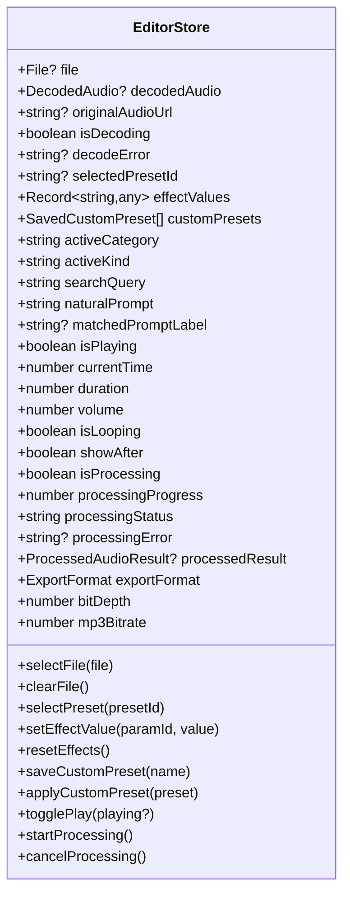

# System Architecture

## 1. High-Level Architecture Overview

Audify is architected as a **hybrid Next.js 16 application**:
- **Server Tier:** Delivers pre-rendered HTML, educational guide content (Static Site Generation), metadata, and a hardened contact endpoint (`/api/contact`).
- **Client Tier:** Contains the Web Audio DSP workstation, PCM decoding, offline rendering pipeline, multi-format binary encoders, and state management.

```mermaid
graph TD
    User([User in Browser]) -->|1. Request Page| NextServer[Next.js 16 Server]
    NextServer -->|Static HTML + SSR Shell| User
    
    subgraph Client Browser RAM Sandbox
        User -->|2. Drop Audio File| FileIngestion[File Ingestion & Validation]
        FileIngestion -->|AudioBuffer| DecodedBuffer[(Decoded PCM 32-bit Float Buffer)]
        
        User -->|3. Select Preset / Adjust Sliders| StateStore[Zustand Store: editor-store.ts]
        StateStore -->|Effect Parameters| DSPPlan[DSP Plan Generator: dsp-plan.ts]
        
        DecodedBuffer -->|Audition| RealtimeGraph[Real-time Web Audio Graph: AudioContext]
        DSPPlan --> RealtimeGraph
        RealtimeGraph --> Speakers([Device Audio Output])
        
        DecodedBuffer -->|Render & Export| OfflineEngine[OfflineAudioContext Renderer: renderer.ts]
        DSPPlan --> OfflineEngine
        OfflineEngine --> PeakLimiter[Look-Ahead Soft-Knee Peak Limiter: -0.3 dBFS]
        PeakLimiter --> Encoders[Binary Encoders: WAV / AIFF / MP3]
        Encoders --> ExportBlob[Blob / Revocable Object URL]
        ExportBlob -->|Download| User
    end
    
    subgraph External Optional Services
        User -.->|Contact Form Submission| ContactAPI[/api/contact]
        ContactAPI -.->|Optional Dispatch| Resend[Resend Email API]
        ContactAPI -.->|Optional Webhook| Webhook[Webhook Endpoint]
    end
```

---

## 2. In-Memory Web Audio DSP Pipeline

Unlike legacy audio converters that require uploading multimegabyte files to cloud servers, Audify processes everything inside browser memory using the W3C Web Audio API.

### Audio Flow Lifecycle

1. **Ingestion & Validation (`src/lib/audio/decoding.ts`)**
   - File size is checked against the **10 MB memory ceiling** (`siteConfig.maxFileSizeBytes`) to protect against tab OOM crashes.
   - Decoded using `AudioContext.decodeAudioData()`.
   - Extracted into linear 32-bit float channels, duration, sample rate, and PCM peak analysis data.

2. **DSP Planning (`src/lib/audio/dsp-plan.ts`)**
   - Parameters from the active preset and slider adjustments are compiled into an immutable `DSPPlan` object.
   - Operations include:
     - `VarispeedPlayback`: Mathematical pitch and tempo scaling ($432\text{ Hz}$, Nightcore, Daycore, Slowed).
     - `BiquadFilter`: Lowpass, highpass, bandpass, peaking EQ, low-shelf, and high-shelf.
     - `ConvolutionReverb`: Synthesized synthetic impulse responses (Room, Hall, Cathedral, Bathroom).
     - `StereoPanner` / `StereoWidener`: Phase-inverted Haas delays and sinusoidal 8D orbital panning.
     - `WaveShaper`: Non-linear tanh polynomial curves for analog tape and tube drive.

3. **Offline Rendering (`src/lib/audio/renderer.ts`)**
   - Executed using an `OfflineAudioContext`.
   - Renders audio significantly faster than real-time (often 5–20× playback speed depending on CPU).
   - Provides granular progress callbacks to the UI without blocking the browser thread.
   - Supports instantaneous cancellation via `isCancelled` abort callbacks.

4. **Peak Limiting & Headroom Protection (`src/lib/audio/dsp-utils.ts`)**
   - Rendered audio passes through a sliding-window look-ahead soft-knee limiter.
   - Enforces a strict **−0.3 dBFS** ceiling, protecting against sample-level digital clipping.

5. **Binary Encoding (`src/lib/audio/encoders.ts`)**
   - **WAV:** Direct binary RIFF byte construction supporting 16-bit PCM integer, 24-bit PCM integer, and 32-bit IEEE 754 float formats.
   - **AIFF:** Big-endian broadcast audio file creation.
   - **MP3:** Constant Bitrate (CBR 128, 192, or 320 kbps) encoding via bundled `lamejs`.

---

## 3. State Management Architecture

State is centralized in **Zustand** at [`src/stores/editor-store.ts`](file:///c:/Users/Yash%20Shinde/OneDrive/%E0%B9%80%E0%B8%AD%E0%B8%81%E0%B8%AA%E0%B8%B2%E0%B8%A3/Projects/Audify/src/stores/editor-store.ts).



### Store Highlights
- **Stale Result Invalidation:** Adjusting any effect parameter or selecting a new preset automatically resets `processedResult` or flags the output as needing re-rendering.
- **A/B Dry/Wet Auditioning:** `showAfter` toggles between the dry original audio buffer and the wet processed result without resetting the playback cursor.
- **Persistent User Presets:** Custom presets are stored in `localStorage` under `audify-custom-presets-v1` and can be exported/imported as JSON.

---

## 4. Server & Edge Runtime Boundaries

Audify's Next.js App Router boundaries are strictly enforced:
- **Server Components (Default):** Static marketing sections, metadata generation, sitemaps, RSS/articles, and `/api/contact`.
- **Client Components (`"use client"`):** Studio workstation, interactive waveform player, preset explorer, custom slider controls, canvas animations, and theme switcher.
